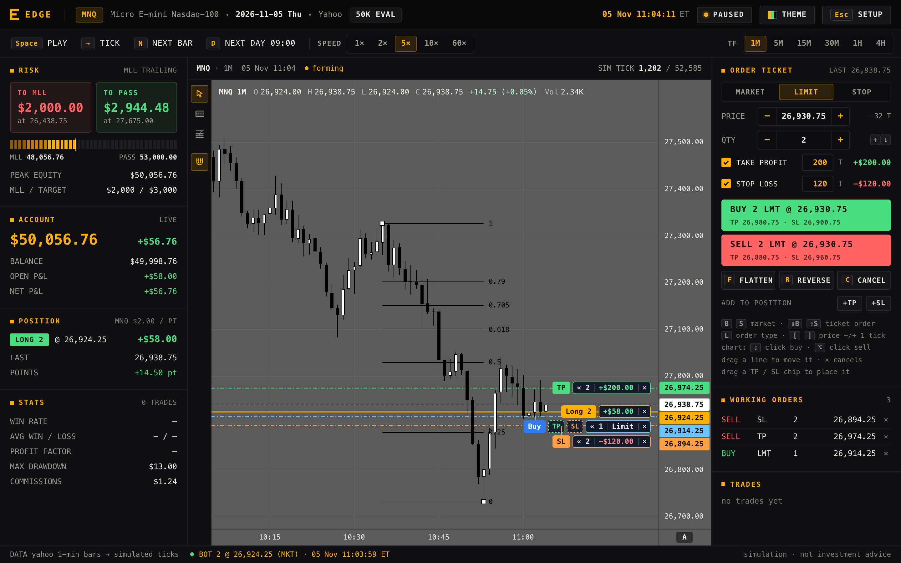
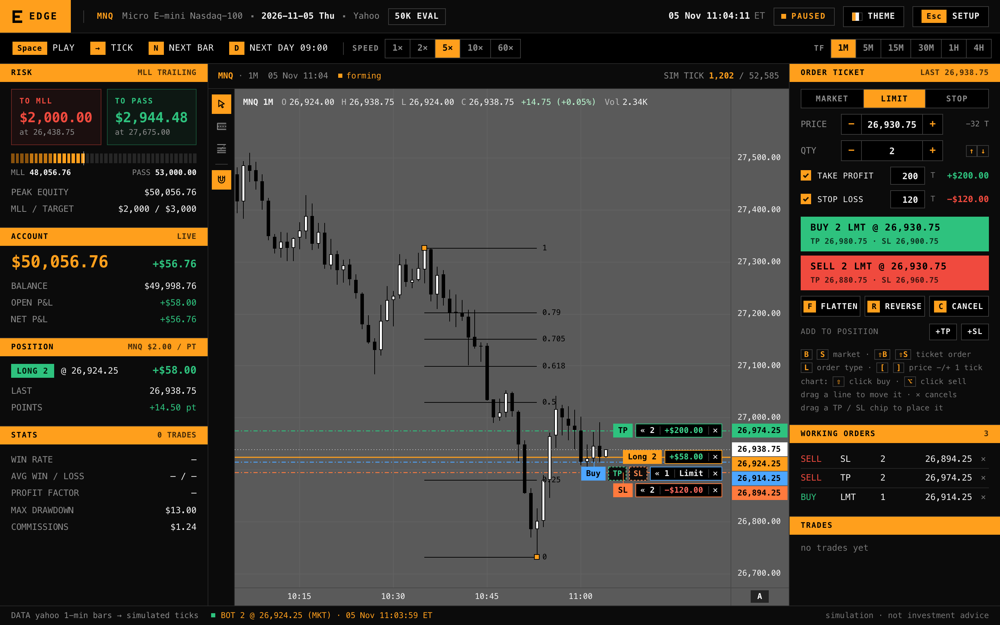
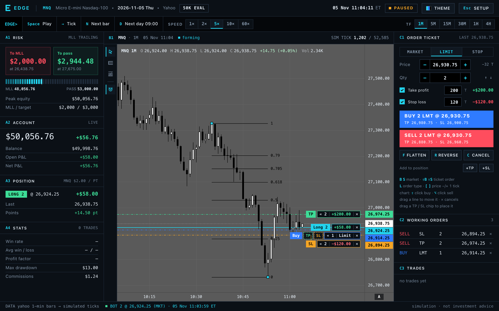
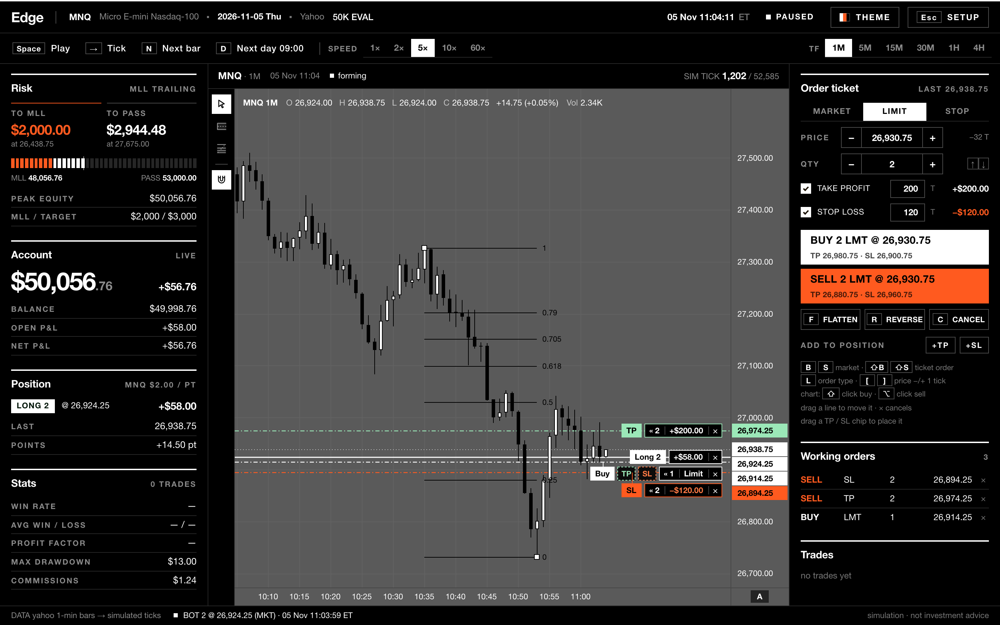
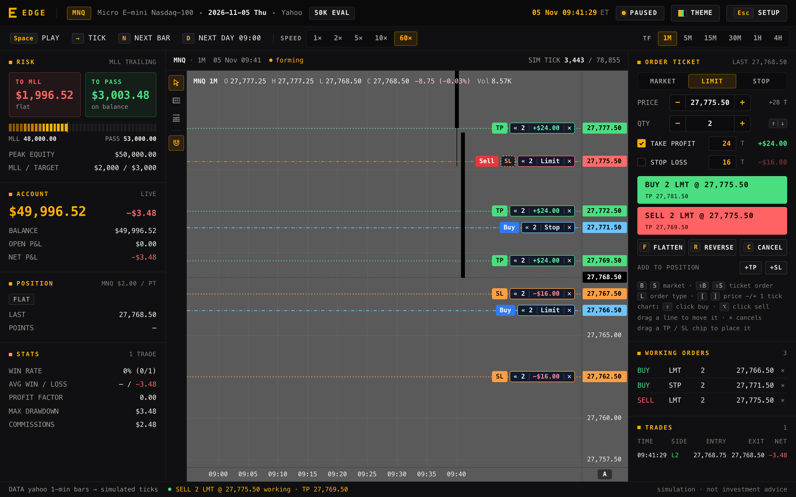
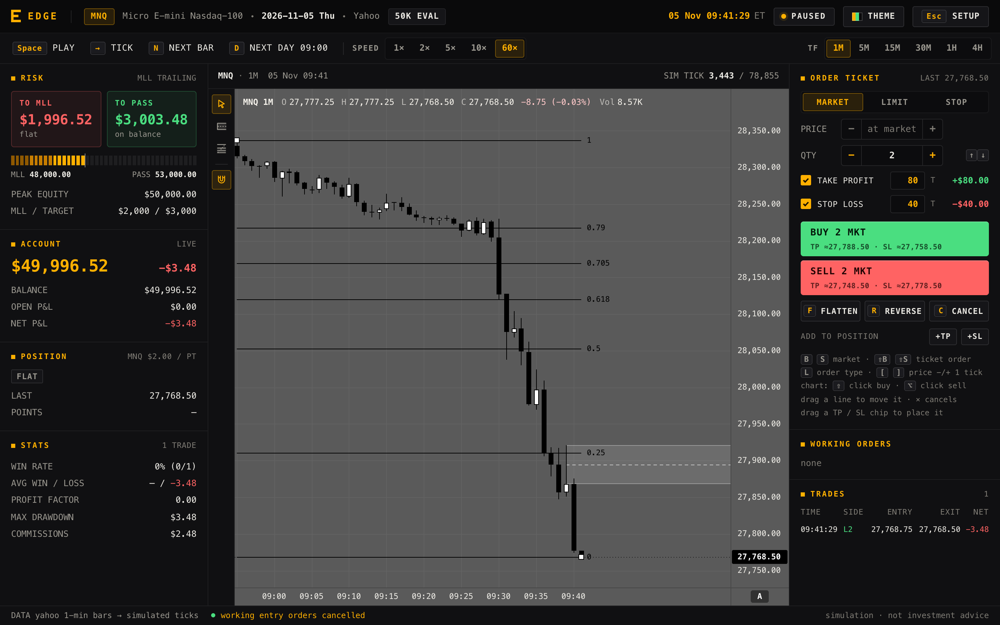

# Edge

**Tick-by-tick replay for MNQ and MES futures: practise a prop-firm evaluation until you pass or blow it.**

**[Download for macOS](https://github.com/unpaidfunds/edge/releases/latest/download/Edge-mac.zip)** ·
**[Download for Windows](https://github.com/unpaidfunds/edge/releases/latest/download/Edge-windows-x64.zip)** ·
[All releases](https://github.com/unpaidfunds/edge/releases)

---

## Features

- **Tick-by-tick replay** of MNQ and MES: every candle forms print by print, so you watch the wicks being made while you trade.
- **Speed 1× to 60×**: play, pause, step one tick, jump to the next candle.
- **Skip to the next day 09:00**: done for the day? Jump straight to the next session. Orders, brackets and the drawdown
  still run through every skipped tick.
- **Prop-firm evaluations** for 25K, 50K and 100K accounts (or custom): a **trailing intraday max loss limit (MLL)** and a
  **pass target**, checked on every tick, with a clear **PASSED** or **BLOWN** result.
- **Order ticket**: market, limit and stop orders with take-profit and stop-loss, quantity and live dollar values.
- **TradingView-style chart**: free panning and zoom, independent price and time axes, order lines you drag to move,
  and TP / SL you drag straight onto the chart.
- **Drawing tools**: rejection block (with its 50 % line) and OTE fib, saved per instrument.
- **Timeframes** 1M · 5M · 15M · 30M · 1H · 4H, all forming tick by tick.
- **4 themes**: Edge, Amber Terminal, Cold Grid and Mono Signal.
- **Free data**: Yahoo Finance 1-minute bars, cached on your computer, plus **CSV import** of your own bars or real ticks
  (TradingView, Databento, NinjaTrader and generic formats).
- Runs **fully offline** once data is cached. No account, no keys, nothing to pay.

## Screenshots

| Edge | Amber Terminal |
|---|---|
|  |  |
| **Cold Grid** | **Mono Signal** |
|  |  |

**New evaluation:** account size, MLL, pass target, instrument, session, start time, timeframe, speed and theme.

**Order ticket:** market, limit and stop with take-profit and stop-loss, every order as a line on the chart.

**Drawings:** rejection block and OTE fib.

**The result:** blown or passed. Restart replays exactly the same ticks.

| Blown | Passed |
|---|---|
|  |  |

## Download and install

| | File | Runs on |
|---|---|---|
| macOS | `Edge-mac.zip` | macOS 11 or later |
| Windows | `Edge-windows-x64.zip` | Windows 10 / 11, 64-bit |

**macOS**

1. Unzip and move **Edge.app** to Applications.
2. The app is not signed by Apple, so the first launch is blocked. **Right-click Edge.app › Open › Open**,
   or open it once, then go to **System Settings › Privacy & Security** and click **Open Anyway**.
3. After that it opens normally.

**Windows**

1. Unzip. Keep the **Edge** folder together and run **Edge.exe** inside it.
2. SmartScreen may warn about an unknown publisher: click **More info › Run anyway**.
3. Edge uses the **Microsoft Edge WebView2 runtime**, which is preinstalled on Windows 10 and 11.
   If the window does not open, install the runtime from Microsoft and start Edge again.

Your data and settings are kept in `~/Library/Application Support/Edge` (macOS) or `%APPDATA%\Edge` (Windows).

## Data

- Market data comes free from **Yahoo Finance** (1-minute bars). Yahoo only serves the **last ~30 days** of 1-minute
  data, so Edge **caches every download** on your computer: open it at least once a month and your history keeps growing.
- Each 1-minute bar is replayed as realistic **simulated ticks** that respect its open, high, low and close.
  Import real tick data (CSV) to replay the actual prints instead.
- Two **synthetic sample sessions** are included so Edge works out of the box. They are labelled *SAMPLE* and are not market data.
- Yahoo data is for personal use and belongs to its providers.

## Disclaimer

**Simulation · not investment advice.** Edge is a practice tool. Results in a replay say nothing about results in a live market.

## License

All rights reserved — source not public. See [LICENSE.txt](LICENSE.txt).
