
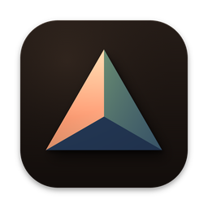

# Edge

**Tick-by-tick replay for MNQ and MES futures: practise a prop-firm evaluation until you pass or blow it, in a chart that works like TradingView.**

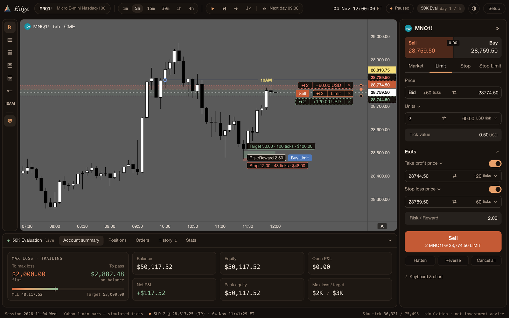

**[Download for macOS](https://github.com/unpaidfunds/edge/releases/latest/download/Edge-mac.zip)** ·
**[Download for Windows](https://github.com/unpaidfunds/edge/releases/latest/download/Edge-windows-x64.zip)** ·
[All releases](https://github.com/unpaidfunds/edge/releases)

---

## Features

- **Tick-by-tick replay** of MNQ and MES: every candle forms print by print, so you watch the wicks being made while you trade.
- **Backtest a timespan**: 1 day, 1 week, 2 weeks, 1 month or any range: pick or drag any two dates on the calendar (drag a circle to move just that end), drag the handles on the timeline of your cached sessions, or nudge it with ← →. The replay runs day after day until the span ends.
- **Speed 1× to 60×**: play, pause, step one tick, jump to the next candle, or **skip to the next day 09:00**. Toggle a **playhead** line at the replay's current time. Orders, brackets and the drawdown still run through every skipped tick.
- **Prop-firm evaluations** for 25K, 50K and 100K accounts (or custom): a **trailing intraday max loss limit (MLL)** and a **pass target**, checked on every tick, with a clear **Passed** or **Blown** result.
- **TradingView-style order panel**: Sell | Buy, Market · Limit · Stop · Stop Limit, units or **USD risk**, take profit and stop loss in price or ticks, risk / reward.
- **Projected order on the chart**, just like TradingView: drag it and its TP / SL into place, then click its Buy / Sell pill to send it. Every order, TP and SL is a line you can drag, with × to cancel.
- **Drawing tools**: long and short **position tools** (risk / reward, one click to place the trade), rejection block, OTE fib, the **10AM line**, a horizontal ray and a **parallel channel**. Hold **⌘** to snap to the candle; one button removes them all.
- **Timeframes** 1m · 5m · 15m · 30m · 1h · 4h, all forming tick by tick. Free panning in every direction, scroll to zoom time, independent price and time scales.
- **Dark or Cream, Mono or Heat**: four colour schemes, with terracotta, sage and slate telling the parts of the screen apart (all white in Mono). Your own **chart colours** if you want them.
- **App icon**: Default, Mono, Heat or match the palette. On macOS it stays after you quit.
- **Account manager**: balance, equity, P&L, the MLL and the target, positions, orders, history and stats.
- **Free data**: Yahoo Finance 1-minute bars, cached on your computer, plus **CSV import** of your own bars or real ticks
  (TradingView, Databento, NinjaTrader and generic formats).
- Runs **fully offline** once data is cached. No account, no keys, nothing to pay.

## Screenshots

| Dark · Heat | Dark · Mono |
|---|---|
|  | 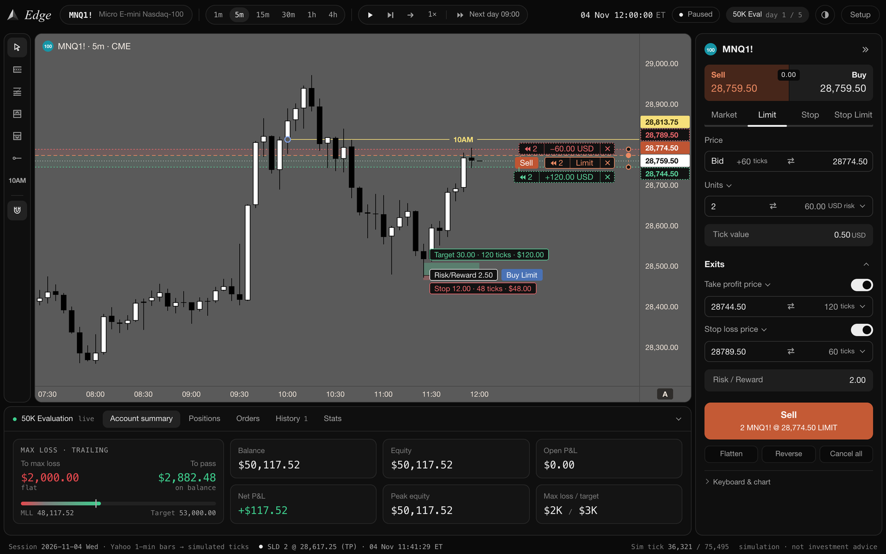 |
| **Cream · Heat** | **Cream · Mono** |
| 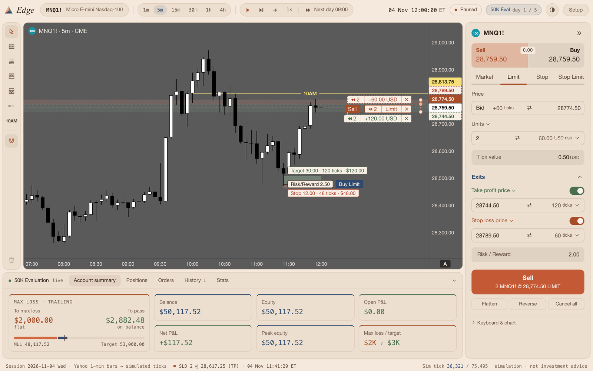 | 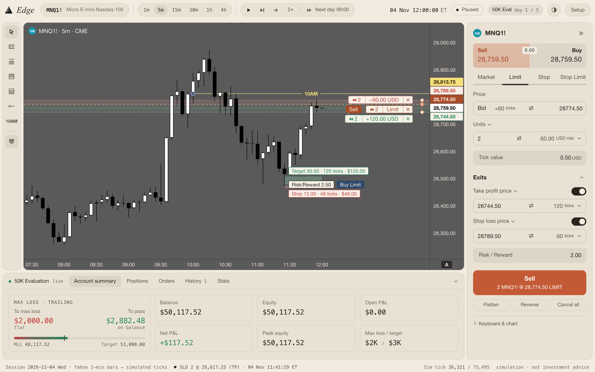 |

**New backtest:** market, timespan, account rules and replay settings.

| Heat | Mono |
|---|---|
| 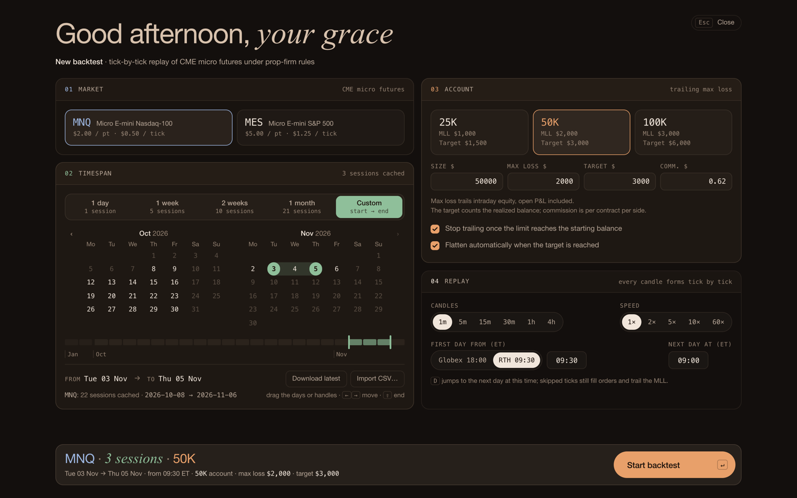 | 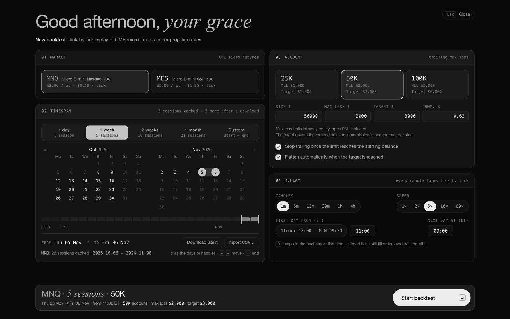 |

**Drawing tools:** position tools with risk / reward and a button to place the trade, the 10AM line, rays, parallel channel, rejection block and OTE.

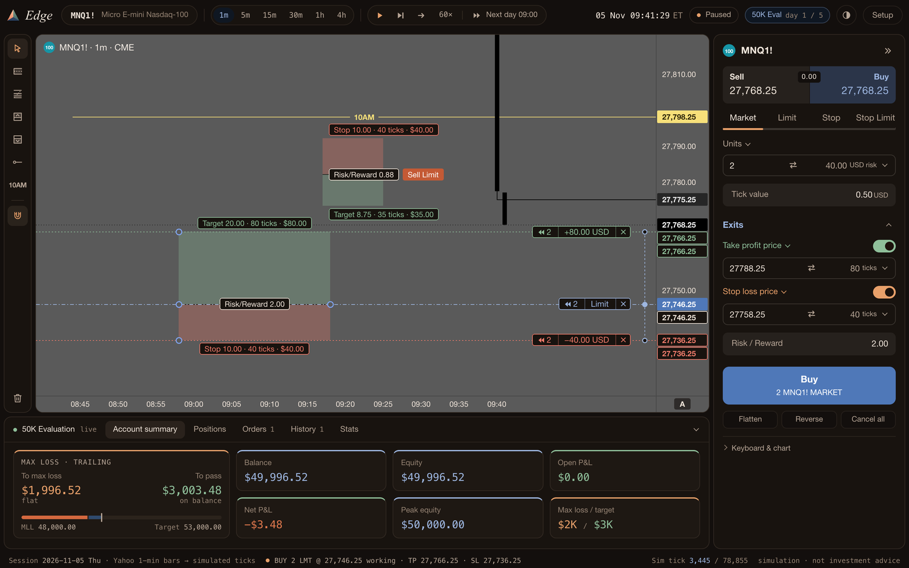

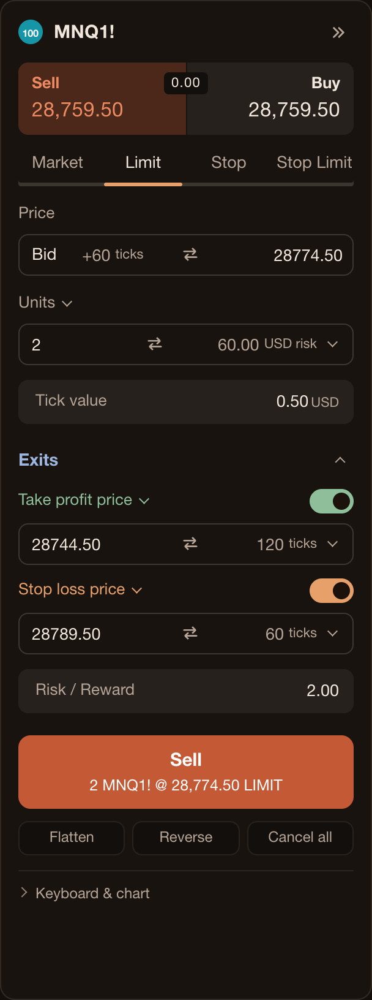

**Order panel:** the TradingView order panel. Pick a side, an order type, the size in contracts or USD risk, and the exits.
The chart shows the order before you send it.

 

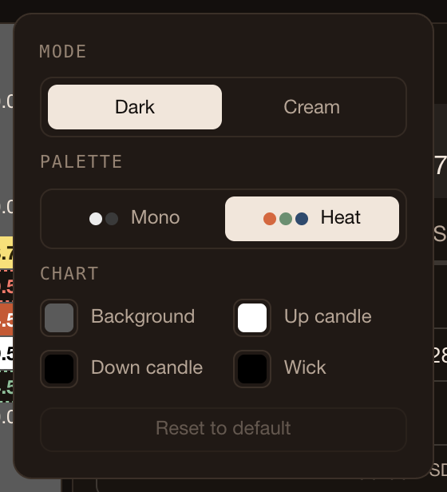

**Appearance:** mode, palette, app icon and chart colours, all in one place.

 

**The result:** blown or passed. Restart replays exactly the same ticks.

| Blown | Passed |
|---|---|
| 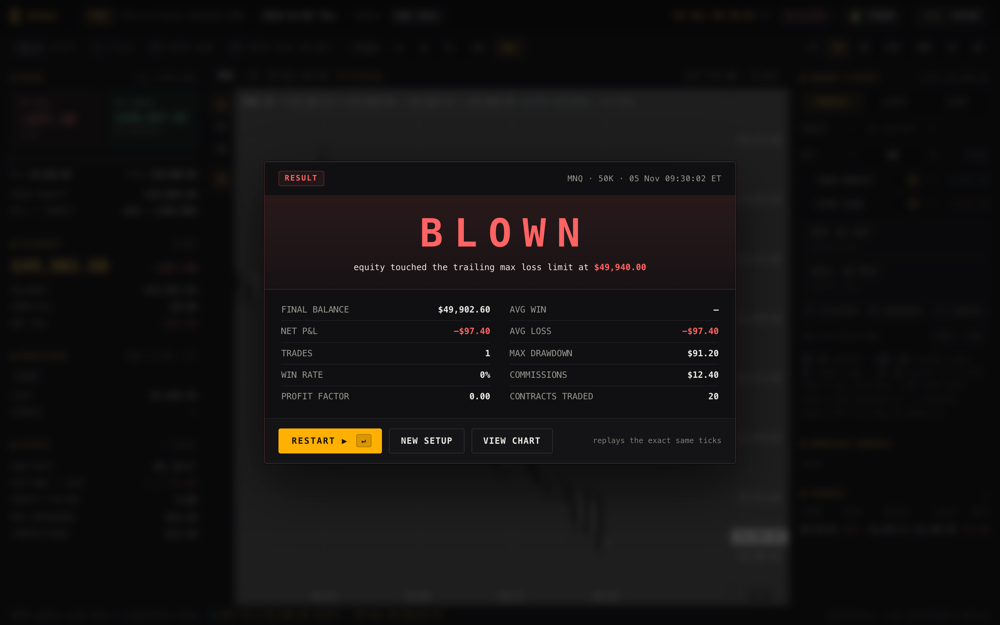 | 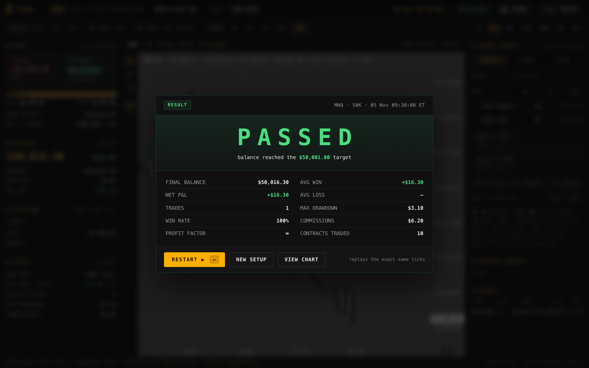 |

## Download and install

| | File | Runs on |
|---|---|---|
| macOS | `Edge-mac.zip` | macOS 11 or later, Apple Silicon |
| Windows | `Edge-windows-x64.zip` | Windows 10 / 11, 64-bit |

**macOS**

1. Unzip and move **Edge.app** to Applications.
2. The app is not signed by Apple, so the first launch is blocked. **Right-click Edge.app › Open › Open**,
   or open it once, then go to **System Settings › Privacy & Security** and click **Open Anyway**.
3. After that it opens normally.

**Windows**

1. Unzip. Keep the **Edge** folder together and run **Edge.exe** inside it.
2. SmartScreen may warn about an unknown publisher: click **More info › Run anyway**.
3. Edge uses the **Microsoft Edge WebView2 runtime**, which is preinstalled on Windows 10 and 11.
   If the window does not open, install the runtime from Microsoft and start Edge again.

Your data and settings are kept in `~/Library/Application Support/Edge` (macOS) or `%APPDATA%\Edge` (Windows).

## Data

- Market data comes free from **Yahoo Finance** (1-minute bars). Yahoo only serves the **last ~30 days** of 1-minute
  data, so Edge **caches every download** on your computer: open it at least once a month and your history keeps growing.
- Each 1-minute bar is replayed as realistic **simulated ticks** that respect its open, high, low and close.
  Import real tick data (CSV) to replay the actual prints instead.
- Two **synthetic sample sessions** are included so Edge works out of the box. They are labelled *SAMPLE* and are not market data.
- Yahoo data is for personal use and belongs to its providers.

## Disclaimer

**Simulation · not investment advice.** Edge is a practice tool. Results in a replay say nothing about results in a live market.

## License

All rights reserved — source not public. See [LICENSE.txt](LICENSE.txt).
